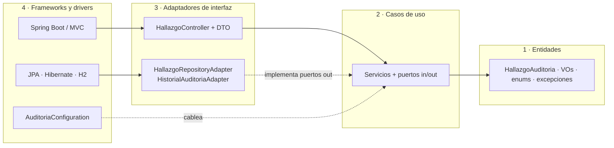

# Auditoría de hallazgos: Clean Architecture con Spring Boot 3 y Java 17

Servicio REST que gestiona el ciclo de vida de **hallazgos de auditoría** (registro, remediación, verificación y cierre), con bitácora de trazabilidad y tablero de indicadores. Es la entrega de la actividad *Patrones Arquitectónicos II: Clean Architecture y análisis costo-beneficio de CQRS / Event Sourcing*.

El diseño tiene dos objetivos: que **las reglas de negocio no dependan de ningún framework** y que la decisión de no usar CQRS ni Event Sourcing completos quede **argumentada con criterios**, no por costumbre.

## Contenido

1. [Alcance funcional](#1-alcance-funcional)
2. [Estructura de paquetes y los cuatro círculos](#2-estructura-de-paquetes-y-los-cuatro-círculos)
3. [Decisiones de diseño](#3-decisiones-de-diseño)
4. [Análisis costo-beneficio de CQRS y Event Sourcing](#4-análisis-costo-beneficio-de-cqrs-y-event-sourcing)
5. [Guía de ejecución](#5-guía-de-ejecución)
6. [Referencia de la API](#6-referencia-de-la-api)
7. [Pruebas](#7-pruebas)
8. [Limitaciones y próximos pasos](#8-limitaciones-y-próximos-pasos)

---

## 1. Alcance funcional

Un hallazgo nace **ABIERTO** y recorre una máquina de estados con transiciones explícitas:

```
ABIERTO ──► EN_REMEDIACION ──► EN_VERIFICACION ──► CERRADO
                  ▲                   │
                  └──── (rechazo) ────┘
```

| Regla de negocio | Dónde vive |
|---|---|
| Solo existen las transiciones de la tabla anterior; `CERRADO` es terminal | `EstadoHallazgo` y `HallazgoAuditoria` |
| Iniciar la remediación exige un plan (responsable, acción y fecha de compromiso) | `PlanRemediacion` |
| La fecha de compromiso no puede estar en el pasado ni superar el plazo de la severidad: `BAJA` 90 días, `MEDIA` 30, `ALTA` 15, `CRITICA` 7 | `Severidad` y `HallazgoAuditoria.validarPlazo` |
| Enviar a verificación exige evidencia; cerrar exige comentario de cierre | `HallazgoAuditoria` |
| Cada cambio de estado deja una fila inmutable en la bitácora, en la misma transacción | `HistorialAuditoriaPort` |
| El tablero agrega por estado y severidad y calcula el tiempo medio de cierre | `ObtenerDashboardAuditoriaService` |

## 2. Estructura de paquetes y los cuatro círculos

```
src/main/java/com/rincon/auditoria
├── AuditoriaApplication.java            ← arranque (círculo 4)
├── domain                               ← CÍRCULO 1: entidades
│   ├── model
│   │   ├── HallazgoAuditoria            Aggregate Root
│   │   ├── HallazgoId                   Value Object (identidad)
│   │   ├── PlanRemediacion              Value Object
│   │   ├── CambioEstado                 hecho inmutable emitido por el agregado
│   │   ├── EstadoHallazgo               enum con la máquina de estados
│   │   ├── Severidad                    enum con el plazo de remediación
│   │   └── Texto                        validación compartida (package-private)
│   └── exception                        DomainException y sus especializaciones
├── usecase                              ← CÍRCULO 2: casos de uso
│   ├── port.in                          interfaces de casos de uso y sus comandos
│   ├── port.out                         HallazgoRepositoryPort, HistorialAuditoriaPort, UnidadDeTrabajoPort
│   ├── service                          implementaciones (sin anotaciones de framework)
│   └── dto                              modelos de lectura del dashboard
└── infrastructure
    ├── web                              ← CÍRCULO 3: adaptadores de entrada
    │   ├── HallazgoController
    │   ├── ManejadorGlobalExcepciones   (@RestControllerAdvice)
    │   └── dto                          requests y responses
    ├── persistence                      ← CÍRCULO 3: adaptadores de salida
    │   ├── HallazgoRepositoryAdapter
    │   └── HistorialAuditoriaAdapter    (más el mapeo dominio ↔ JPA)
    │                                    ← CÍRCULO 4: entidades JPA y repositorios Spring Data
    └── config
        └── AuditoriaConfiguration       ← CÍRCULO 4: raíz de composición
```



**Regla de dependencia:** el código fuente solo apunta hacia adentro. Cuando el caso de uso necesita algo de afuera (guardar, registrar historial, abrir una transacción) declara un **puerto** y la infraestructura lo implementa: la dependencia se invierte.

| Círculo | Qué contiene | Puede importar | Prohibido importar |
|---|---|---|---|
| 1. Entidades (`domain`) | Agregado, value objects, estados, excepciones | Solo JDK | Spring, JPA, Jackson, `usecase`, `infrastructure` |
| 2. Casos de uso (`usecase`) | Un servicio por intención del usuario, puertos de entrada y de salida | `domain` y JDK | Spring, JPA, `infrastructure` |
| 3. Adaptadores (`infrastructure.web`, `infrastructure.persistence`) | Controlador, DTO, traducción de excepciones, mapeo dominio ↔ tabla | Círculos 1 y 2, Spring | Que `web` conozca a `persistence` |
| 4. Frameworks (`AuditoriaApplication`, `config`, entidades JPA, Spring Data, H2) | Detalles reemplazables y cableado | Todo | Lógica de negocio |

Esta regla **no depende de la disciplina del equipo**: `ArquitecturaTest` (ArchUnit) falla el build si `domain` o `usecase` importan `org.springframework`, `jakarta`, `org.hibernate` o `com.fasterxml`, o si un círculo interno importa uno externo.

## 3. Decisiones de diseño

Cada decisión sigue el formato *contexto, decisión, alternativas, consecuencias*.

### D1. Los puertos los define el caso de uso y los implementa la infraestructura

- **Contexto.** Los servicios necesitan persistir hallazgos, anotar la bitácora y ejecutar varias escrituras de forma atómica. Si importaran `JpaRepository` o `@Transactional`, el círculo 2 dependería del 4.
- **Decisión.** `HallazgoRepositoryPort`, `HistorialAuditoriaPort` y `UnidadDeTrabajoPort` viven en `usecase.port.out`. Los servicios no llevan `@Service` ni `@Transactional`: reciben sus puertos y un `java.time.Clock` por constructor y se registran como beans en `AuditoriaConfiguration`, la única clase que conoce ambos lados. La transacción se expresa como *Unit of Work* (`UnidadDeTrabajoPort.ejecutar(Supplier)`), implementada con `TransactionTemplate`.
- **Alternativas.** (a) `@Service` + `@Transactional` en los casos de uso: más corto, pero ata el círculo 2 a Spring y obliga a levantar el contexto para probarlo. (b) `@Transactional` en el adaptador: no cubre la atomicidad entre *guardar hallazgo* e *insertar historial*, que son dos adaptadores.
- **Consecuencias.** Los casos de uso se prueban con puertos en memoria en milisegundos (`CasosDeUsoTest`). Cambiar H2 por PostgreSQL, o JPA por JDBC, no toca los círculos 1 ni 2. A cambio hay más clases y un archivo de cableado explícito.

### D2. El agregado encapsula la máquina de estados; los conceptos con reglas propias son Value Objects

- **Contexto.** Si las transiciones se validaran en los servicios o el controlador, cualquier ruta nueva podría saltárselas y dejar un hallazgo `CERRADO` sin haber sido verificado.
- **Decisión.** `HallazgoAuditoria` es el *Aggregate Root*: los campos de estado son privados y solo cambian mediante `iniciarRemediacion`, `enviarAVerificacion`, `rechazarVerificacion` y `cerrar`. La tabla de transiciones vive en `EstadoHallazgo` y cada operación exige su estado de origen exacto (`exigirTransicion`). `HallazgoId` y `PlanRemediacion` son *records* inmutables que validan en su constructor, de modo que no existe un plan inválido en memoria. El tiempo entra como parámetro (`Instant ahora`), lo que vuelve el dominio determinista.
- **Alternativas.** (a) Modelo anémico con la lógica en servicios: más simple, pero las invariantes quedan dispersas. (b) Un patrón *State* con una clase por estado: sobredimensionado para cuatro estados y una sola variación de comportamiento.
- **Consecuencias.** Las reglas se prueban sin infraestructura (`HallazgoAuditoriaTest`). Esa suite detectó un defecto real durante el desarrollo: `EN_REMEDIACION` es destino válido desde `ABIERTO` y desde `EN_VERIFICACION`, así que validar solo contra la tabla dejaba pasar `iniciarRemediacion` desde `EN_VERIFICACION`. La corrección fue exigir el origen exacto por operación.

### D3. El modelo de persistencia está separado del dominio

- **Contexto.** Anotar el agregado con `@Entity` lo obligaría a tener constructor sin argumentos, setters y campos mutables, y el esquema condicionaría el modelo.
- **Decisión.** `HallazgoJpaEntity` es un modelo de tabla independiente, con campos visibles solo dentro de su paquete. `HallazgoRepositoryAdapter` traduce en ambos sentidos y rehidrata el agregado con `HallazgoAuditoria.reconstruir`, que no vuelve a ejecutar las reglas de creación. La entidad lleva `@Version` para **bloqueo optimista**: al cargar y guardar dentro de la misma unidad de trabajo, dos operaciones concurrentes sobre el mismo hallazgo producen un conflicto (HTTP 409) en lugar de una sobrescritura silenciosa.
- **Alternativas.** Entidad de dominio = entidad JPA. Se descartó porque rompe la regla de dependencia (el círculo 1 importaría `jakarta.persistence`).
- **Consecuencias.** Hay código de mapeo que mantener. Se acepta porque aísla al dominio de cambios de esquema.

### D4. La trazabilidad es una bitácora append-only, emitida por el agregado

- **Contexto.** Un hallazgo de auditoría debe poder responder *qué pasó, cuándo y por qué* en cada cambio de estado.
- **Decisión.** El agregado registra un `CambioEstado` en cada transición y el caso de uso lo entrega a `HistorialAuditoriaPort` dentro de la misma transacción que guarda el hallazgo. La tabla `historial_cambio_estado` es **append-only por construcción**: la entidad es `@Immutable` con columnas `updatable = false`, y su repositorio extiende el marcador `Repository` y solo declara `saveAll` y una consulta, de modo que **no existe método de borrado ni de actualización**. El puerto tampoco lo ofrece.
- **Alternativas.** (a) Auditoría con triggers de base de datos: invisible para el dominio y difícil de probar. (b) Event Sourcing: ver la sección 4.
- **Consecuencias.** La tabla de hallazgos sigue siendo la fuente de verdad del estado actual y la bitácora es un registro derivado y consultable (`GET /{id}/historial`). Cubre la necesidad de trazabilidad con una fracción del costo.

## 4. Análisis costo-beneficio de CQRS y Event Sourcing

**Conclusión anticipada.** Se adopta **Clean Architecture con bitácora append-only y consultas de lectura separadas (CQRS ligero)**. No se adopta CQRS completo ni Event Sourcing. Las cifras de esta sección son **supuestos de dimensionamiento** del contexto de la actividad, no mediciones.

### Qué se evalúa

| Opción | Qué implica |
|---|---|
| **CQRS completo** | Modelo y almacén de escritura distintos de los de lectura; las proyecciones se actualizan de forma asíncrona (consistencia eventual) mediante eventos o un bus |
| **Event Sourcing** | El estado se deriva de reproducir una secuencia inmutable de eventos; no existe una tabla "estado actual" como fuente de verdad |
| **Lo implementado** | Una base de datos y un modelo de escritura. Los casos de uso de lectura (`ObtenerDashboardAuditoriaService`, `ConsultarHistorialService`) usan puertos y DTO propios, con proyecciones `GROUP BY` y `AVG` resueltas en la base de datos. La bitácora es una tabla append-only |

### Pregunta 1. ¿Qué escala exige el sistema?

- **Volumen supuesto.** Una auditoría genera del orden de cientos a pocos miles de hallazgos al año, gestionados por decenas de usuarios. Aun con diez años de datos hablamos de ~10⁴-10⁵ filas.
- **Perfil de carga.** Pocas escrituras (una por transición, cuatro como máximo por hallazgo) y lecturas esporádicas del tablero. No hay picos de escritura que justifiquen aislar el camino de escritura.
- **Lo que cuesta el tablero.** Tres consultas agregadas sobre índices en `estado` y `severidad` (`idx_hallazgo_estado`, `idx_hallazgo_severidad`). A este volumen una base relacional las resuelve con holgura; no hay un cuello de botella de lectura que CQRS deba resolver.
- **Veredicto.** La razón de ser de CQRS y Event Sourcing a gran escala (escalar lecturas y escrituras de forma independiente) **no aplica**.
- **Umbral de revisión.** Reevaluar si el tablero supera un p95 de 300 ms tras agregar índices y réplica de lectura, o si la tabla de hallazgos supera del orden de 10⁷ filas.

### Pregunta 2. ¿Qué complejidad de dominio hay y cuánta se añadiría?

- **Dominio.** Un único agregado, cuatro estados, una tabla de transiciones y un SLA por severidad. Son reglas **ricas en comportamiento pero pequeñas en tamaño**; justifican Clean Architecture, no un patrón de segmentación del modelo.
- **Costo de CQRS completo.** Duplicar modelos, mantener proyecciones, un mecanismo de entrega de eventos con reintentos e idempotencia, y manejar proyecciones desfasadas o rotas.
- **Costo de Event Sourcing.** Versionado de esquemas de eventos, *snapshots* para no reproducir miles de eventos, herramientas para corregir datos (no se hace `UPDATE`, se compensa con eventos), y una curva de aprendizaje que el equipo debe pagar desde el primer día.
- **Beneficio a cambio.** Ninguno de ellos resuelve un problema que hoy exista: no hay varios *bounded contexts* ni modelos de lectura radicalmente distintos del de escritura.
- **Veredicto.** El costo supera con claridad al beneficio.

### Pregunta 3. ¿Qué nivel de consistencia se requiere?

- **Escrituras.** Cada operación valida contra el **estado actual** (no se puede cerrar lo que no está en verificación) y su respuesta debe reflejar el nuevo estado de inmediato (*read-your-writes*). Eso exige consistencia fuerte en el lado de escritura.
- **Lo implementado.** Una transacción ACID agrupa *cargar hallazgo, mutar, guardar e insertar historial*; si algo falla, no queda un estado sin su registro ni un registro sin su estado. `@Version` evita actualizaciones perdidas.
- **Con CQRS completo.** El tablero se leería de una proyección actualizada de forma asíncrona. En auditoría, un indicador que muestra "3 abiertos" cuando acaba de cerrarse uno erosiona la confianza en el dato, y habría que explicar y monitorear ese desfase.
- **Con Event Sourcing.** La atomicidad *estado + bitácora* se obtiene gratis, pero a cambio de que todo el estado dependa de la reproducción.
- **Veredicto.** Se necesita consistencia fuerte y una sola base de datos la da sin esfuerzo; la consistencia eventual sería un costo sin contrapartida.

### Pregunta 4. ¿Cuál es la naturaleza de la trazabilidad?

- **Lo que se necesita.** Responder *qué cambió, de qué estado a cuál, cuándo y con qué justificación* para cada hallazgo. Es un **registro cronológico de hechos**.
- **Lo que no se necesita.** Reconstruir el estado en un instante arbitrario a partir de eventos, ni derivar nuevas proyecciones del pasado, ni reproducir la historia sobre un modelo distinto. Esos son los casos en los que Event Sourcing paga su costo.
- **Distinción clave.** *Tener historial* no es lo mismo que *derivar el estado del historial*. La bitácora append-only da el primero sin imponer el segundo: el estado vive en la tabla de hallazgos y el historial se escribe en la misma transacción.
- **Garantía de inmutabilidad, con honestidad.** La inmutabilidad se garantiza en la aplicación (sin API de borrado ni de actualización, `@Immutable`). No es resistente a manipulación directa de la base: si la normativa lo exige, se completa con permisos `INSERT`/`SELECT` únicamente sobre esa tabla o con una cadena de hashes. La bitácora tampoco registra al **actor** porque la aplicación aún no tiene autenticación; es la primera extensión necesaria (sección 8).
- **Veredicto.** La necesidad de trazabilidad se cubre con una tabla append-only. Event Sourcing sería una solución para un requisito que no existe.

### Pregunta 5. ¿Qué señales de sobre-ingeniería hay?

| Señal | ¿Se presenta con CQRS/ES completo? |
|---|---|
| Más infraestructura (bus, proyectores, *snapshots*) que reglas de negocio | **Sí**: son cuatro estados y una regla de plazo |
| El modelo de lectura es casi idéntico al de escritura | **Sí**: el tablero son tres agregaciones sobre las mismas filas |
| No hay un requisito explícito de reproducción o consulta temporal | **Sí**: el requisito es de trazabilidad, no de reconstrucción |
| Equipo pequeño sin experiencia previa en el patrón | **Sí**: la curva de aprendizaje compite con la entrega |
| Un solo consumidor de los datos | **Sí**: una API y un tablero |
| Se justifica con "escalará algún día" | **Sí**: no hay una cifra que lo respalde |
| Necesidad medida de escalar lecturas por separado | No |

Seis de siete señales apuntan a sobre-ingeniería, por eso se descarta el patrón completo.

**Autocrítica de lo ya implementado.** También el diseño actual tiene un costo que conviene vigilar: la entidad JPA separada con su mapeo, el puerto de unidad de trabajo y seis casos de uso para un dominio pequeño son más ceremonia de la que necesitaría un CRUD. Se aceptan porque el enunciado pide Clean Architecture y porque aíslan al dominio, pero en un proyecto real sin ese requisito bastaría una arquitectura en capas.

### Qué sí se tomó prestado de CQRS

Separación **conceptual** sin separación de infraestructura: los casos de uso de consulta están separados de los de comando, devuelven modelos de lectura propios (`DashboardAuditoria`) y sus consultas agregan en la base de datos en lugar de cargar agregados. Es la parte del patrón con mejor relación beneficio/costo y deja abierta la puerta para escalar después.

### Cuándo reconsiderar (condiciones de salida)

| Condición | Paso siguiente |
|---|---|
| El tablero degrada la escritura o supera el p95 de 300 ms con índices y réplica de lectura | Vista materializada o proyección actualizada por evento, aún en la misma base |
| Los reportes requieren combinar datos de varios contextos o fuentes | CQRS con un almacén de lectura propio |
| Una normativa exige reconstruir el estado en cualquier fecha pasada o demostrar la inalterabilidad | Event Sourcing solo para el agregado `HallazgoAuditoria`, o bitácora con cadena de hashes |
| Varios equipos o servicios consumen los cambios de estado | *Transactional Outbox* y publicación de eventos de dominio |

| Opción | Escala | Complejidad | Consistencia | Trazabilidad | Veredicto |
|---|---|---|---|---|---|
| CRUD simple | Suficiente | Mínima | Fuerte | Insuficiente sin bitácora | Descartada |
| **Clean + bitácora + CQRS ligero** | **Suficiente** | **Moderada** | **Fuerte** | **Cubierta** | **Elegida** |
| CQRS completo | Sobrada | Alta | Eventual | Cubierta | Descartada |
| Event Sourcing | Sobrada | Muy alta | Fuerte | Excesiva | Descartada |

## 5. Guía de ejecución

### Requisitos

- JDK 17 o superior (se compila con `release 17`)
- Maven 3.9+
- `curl` y, opcionalmente, `jq` para dar formato a las respuestas

### Compilar y probar

```bash
mvn clean package          # compila, ejecuta las 72 pruebas y genera el jar
mvn test                   # solo las pruebas
```

### Arrancar

```bash
java -jar target/auditoria-hallazgos-1.0.0.jar
# o, sin empaquetar:
mvn spring-boot:run
```

La aplicación escucha en `http://localhost:8080`. La base **H2 es en memoria**: se crea al arrancar y los datos **se pierden al detener el proceso**.

### Probar todos los flujos con `curl`

Los comandos siguientes se ejecutaron contra la aplicación en marcha. Copie el bloque completo en una terminal; la fecha de compromiso se calcula a 5 días (con GNU `date`; en macOS use `date -u -v+5d +%F`).

```bash
BASE=http://localhost:8080/api/v1/hallazgos
JSON='Content-Type: application/json'
FECHA=$(date -u -d '+5 days' +%F)

# 1. Registrar un hallazgo (201 Created + cabecera Location)
ID=$(curl -s -X POST $BASE -H "$JSON" -d '{
  "titulo": "Contraseñas almacenadas en texto plano",
  "descripcion": "El módulo de login guarda las claves sin aplicar ningún hash",
  "severidad": "ALTA"}' | jq -r .id)
echo $ID

# 2. Listar, filtrar por estado y consultar uno
curl -s $BASE | jq
curl -s "$BASE?estado=ABIERTO" | jq 'map({id, estado, severidad})'
curl -s $BASE/$ID | jq

# 3. Error esperado: cerrar sin haber remediado -> 400 Bad Request
curl -s -i -X POST $BASE/$ID/cierre -H "$JSON" -d '{"comentarioCierre":"Cierre prematuro"}'

# 4. Error esperado: plan fuera del plazo de la severidad (ALTA = 15 días) -> 400
curl -s -X POST $BASE/$ID/remediacion -H "$JSON" \
  -d '{"responsable":"Ana Pérez","accion":"Migrar a Argon2id","fechaCompromiso":"2099-01-01"}' | jq

# 5. Iniciar la remediación: ABIERTO -> EN_REMEDIACION
curl -s -X POST $BASE/$ID/remediacion -H "$JSON" -d "{
  \"responsable\": \"Ana Pérez\",
  \"accion\": \"Migrar el almacenamiento a Argon2id\",
  \"fechaCompromiso\": \"$FECHA\"}" | jq

# 6. Enviar a verificación, rechazarla y volver a enviarla
curl -s -X POST $BASE/$ID/verificacion -H "$JSON" \
  -d '{"evidencia":"Pull request 42 desplegado en producción"}' | jq '{estado}'
curl -s -X POST $BASE/$ID/rechazo -H "$JSON" \
  -d '{"motivo":"Faltan las cuentas de servicio sin migrar"}' | jq '{estado}'
curl -s -X POST $BASE/$ID/verificacion -H "$JSON" \
  -d '{"evidencia":"Todas las cuentas migradas y comprobadas"}' | jq '{estado}'

# 7. Cerrar: EN_VERIFICACION -> CERRADO
curl -s -X POST $BASE/$ID/cierre -H "$JSON" \
  -d '{"comentarioCierre":"Verificado por el equipo de auditoría"}' | jq

# 8. Historial de trazabilidad (orden cronológico)
curl -s $BASE/$ID/historial | jq

# 9. Dashboard: conteos por estado y severidad, y tiempo medio de cierre
curl -s $BASE/dashboard | jq

# 10. Otros errores: 404, validación por campo y filtro inválido
curl -s -o /dev/null -w "%{http_code}\n" $BASE/2f4c1f0e-6a7b-4c1d-9c3e-0a1b2c3d4e5f
curl -s -X POST $BASE -H "$JSON" -d '{"titulo":"","descripcion":"","severidad":null}' | jq
curl -s -o /dev/null -w "%{http_code}\n" "$BASE?estado=INEXISTENTE"
```

**Respuesta esperada del paso 3** (formato Problem Details, RFC 9457):

```json
{
  "type": "about:blank",
  "title": "Transición de estado inválida",
  "status": 400,
  "detail": "Transición inválida: un hallazgo en estado ABIERTO no puede pasar a CERRADO. Transiciones permitidas desde ABIERTO: [EN_REMEDIACION]",
  "instance": "/api/v1/hallazgos/<id>/cierre",
  "estadoOrigen": "ABIERTO",
  "estadoDestino": "CERRADO"
}
```

**Respuesta esperada del paso 8:**

```json
[
  {"estadoNuevo": "ABIERTO", "detalle": "Hallazgo registrado con severidad ALTA", "...": "..."},
  {"estadoAnterior": "ABIERTO", "estadoNuevo": "EN_REMEDIACION", "detalle": "Plan de Ana Pérez para el <fecha>: Migrar el almacenamiento a Argon2id"},
  {"estadoAnterior": "EN_REMEDIACION", "estadoNuevo": "EN_VERIFICACION", "detalle": "Pull request 42 desplegado en producción"},
  {"estadoAnterior": "EN_VERIFICACION", "estadoNuevo": "EN_REMEDIACION", "detalle": "Verificación rechazada: Faltan las cuentas de servicio sin migrar"},
  {"estadoAnterior": "EN_REMEDIACION", "estadoNuevo": "EN_VERIFICACION", "detalle": "Todas las cuentas migradas y comprobadas"},
  {"estadoAnterior": "EN_VERIFICACION", "estadoNuevo": "CERRADO", "detalle": "Verificado por el equipo de auditoría"}
]
```

> El tiempo hasta el cierre se guarda en **horas enteras**. Al recorrer el flujo en segundos, `horasHastaCierre` y los promedios del dashboard valdrán `0`, aunque `hallazgosCerrados` ya refleje el cierre. Con hallazgos cerrados a lo largo de horas o días el promedio aparece con valores reales.

## 6. Referencia de la API

Base: `/api/v1/hallazgos`

| Método | Ruta | Descripción | Respuestas |
|---|---|---|---|
| `POST` | `/` | Registra un hallazgo (`titulo`, `descripcion`, `severidad`) | 201, 400 |
| `GET` | `/?estado=` | Lista todos o filtra por estado | 200, 400 |
| `GET` | `/{id}` | Obtiene un hallazgo | 200, 400, 404 |
| `POST` | `/{id}/remediacion` | `ABIERTO → EN_REMEDIACION` (`responsable`, `accion`, `fechaCompromiso`) | 200, 400, 404, 409 |
| `POST` | `/{id}/verificacion` | `EN_REMEDIACION → EN_VERIFICACION` (`evidencia`) | 200, 400, 404, 409 |
| `POST` | `/{id}/rechazo` | `EN_VERIFICACION → EN_REMEDIACION` (`motivo`) | 200, 400, 404, 409 |
| `POST` | `/{id}/cierre` | `EN_VERIFICACION → CERRADO` (`comentarioCierre`) | 200, 400, 404, 409 |
| `GET` | `/{id}/historial` | Bitácora de cambios de estado | 200, 400, 404 |
| `GET` | `/dashboard` | Indicadores agregados | 200 |

| Excepción de dominio | Código HTTP |
|---|---|
| `TransicionInvalidaException`, `DatosInvalidosException`, `PlanRemediacionInvalidoException` | 400 Bad Request |
| `HallazgoNoEncontradoException` | 404 Not Found |
| `OptimisticLockingFailureException` (modificación concurrente) | 409 Conflict |
| Cualquier otra | 500, sin exponer detalles internos |

## 7. Pruebas

**72 pruebas JUnit 5, todas sin levantar el contexto de Spring.**

| Suite | Pruebas | Qué valida |
|---|---|---|
| `EstadoHallazgoTest` | 21 | Las 16 combinaciones origen-destino de la máquina de estados, inmutabilidad de la tabla |
| `HallazgoAuditoriaTest` | 19 | Reglas del agregado: plazos por severidad, evidencia, cierre, estado terminal, cambios pendientes, regresión del origen exacto |
| `ValueObjectsTest` | 6 | `HallazgoId`, `PlanRemediacion` y `Severidad` |
| `CasosDeUsoTest` | 6 | Flujo completo sobre puertos en memoria; una transición inválida no escribe en la bitácora |
| `ObtenerDashboardAuditoriaServiceTest` | 3 | Completa valores vacíos y calcula el promedio general ponderado |
| `HallazgoControllerTest` | 11 | HTTP con `MockMvc` en modo *standalone*: 201, 400, 404, mapeo de errores y ruta `/dashboard` |
| `ArquitecturaTest` | 6 | ArchUnit: dominio y casos de uso sin frameworks, sin dependencias hacia afuera, sin ciclos |

## 8. Limitaciones y próximos pasos

- **Sin autenticación**: la bitácora no registra al actor. Es la primera extensión: añadir `usuario` a `CambioEstado` y autorización por rol.
- **Esquema generado por Hibernate** (`create-drop`) y H2 en memoria: apto para la actividad. Para producción, migraciones versionadas (Flyway) y PostgreSQL.
- **Sin paginación** en el listado; se añadiría paginación por cursor antes de tener volumen.
- **Mensajes de Bean Validation** en el idioma por defecto del JVM (inglés); el dominio sí responde en español.
- **Inmutabilidad de la bitácora** garantizada solo a nivel de aplicación (ver pregunta 4).
- **Contrato OpenAPI** no publicado todavía (`springdoc-openapi` sería el paso natural).
